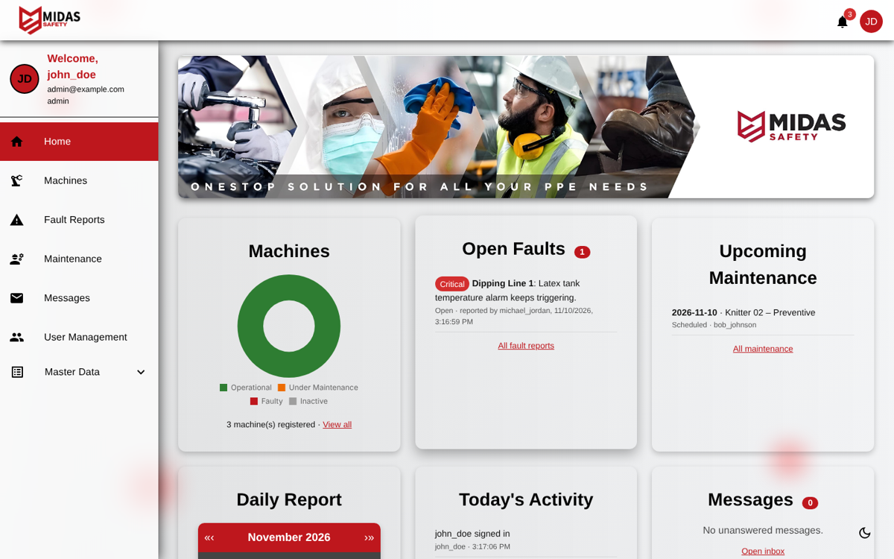
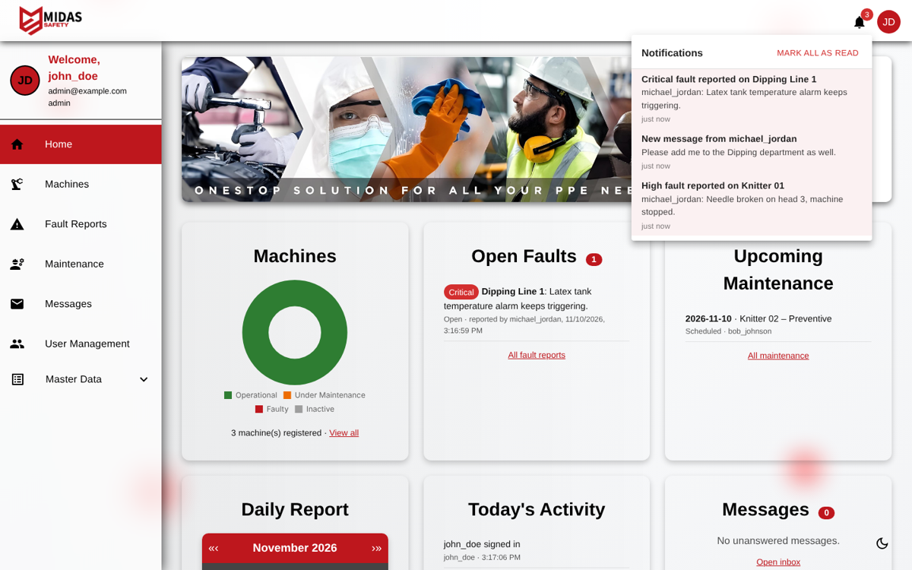
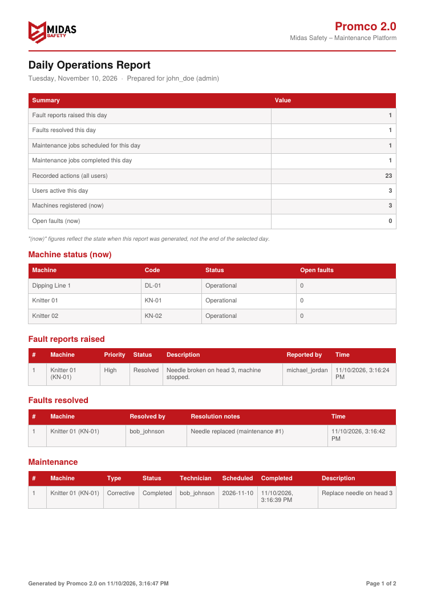
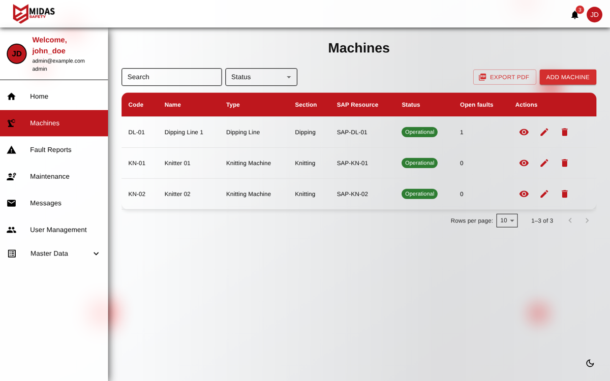
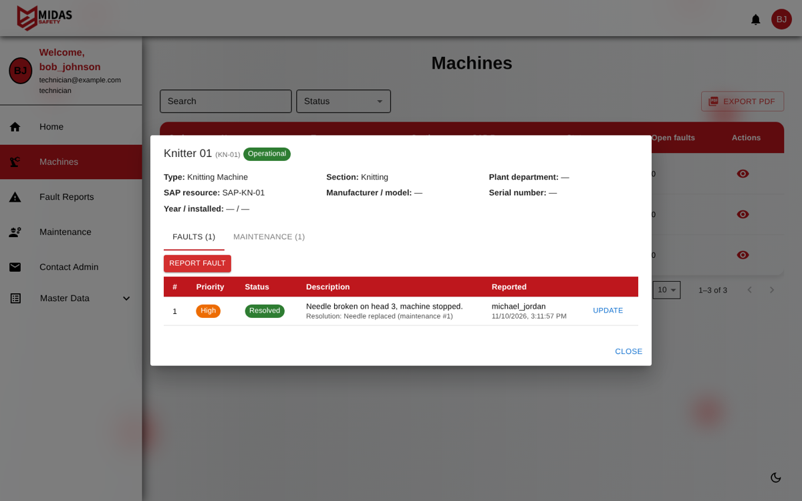
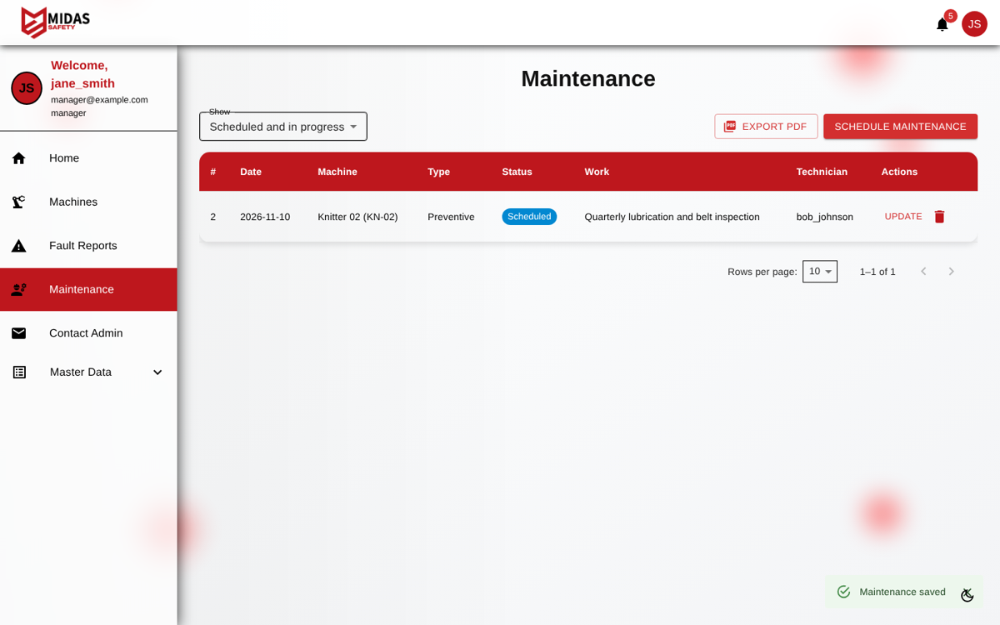
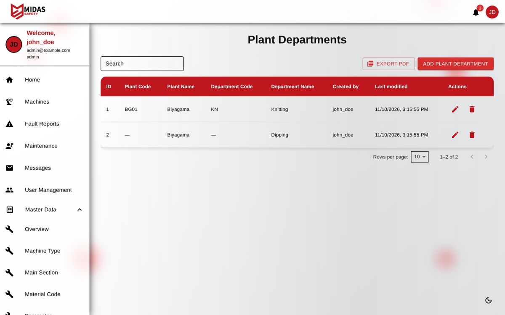
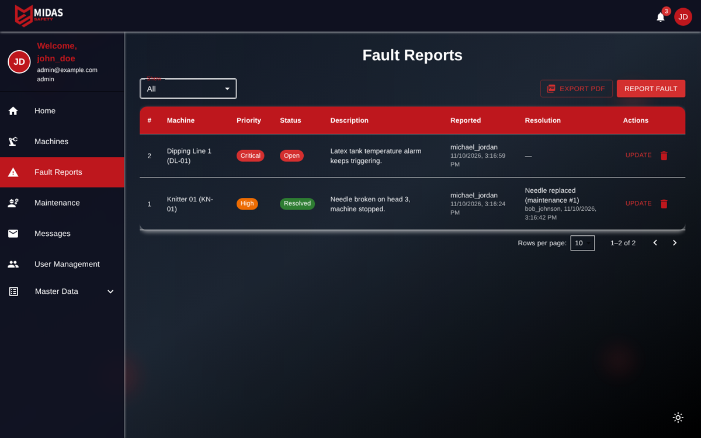
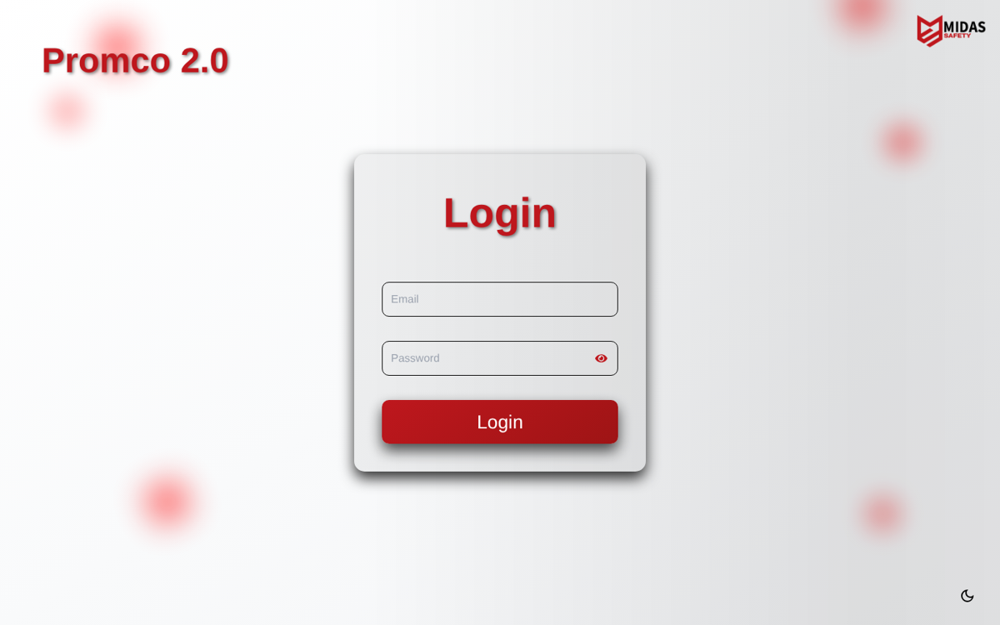

# Promco 2.0 – Midas Safety Maintenance Platform

A full-stack web application for a manufacturing floor: register machines, report faults, schedule and track maintenance, keep plant master data, and download a daily operations report as a PDF. Built as an internship project for **Midas Safety**.



## Features

Everything below works end-to-end against the API; nothing is mocked or simulated.

- **Role-based access**: `admin`, `manager`, `technician`, `operator` and `user` roles, using JWT auth and BCrypt password hashing. The account is re-checked on every request, so a deleted user is locked out immediately and role changes apply right away.
- **Machines**: register machines and link them to a machine type, section and plant department. Each machine has a status and its own fault and maintenance history.
- **Fault reporting**: any user can report a fault with a priority. Technicians, managers and admins move it to *In Progress* and then *Resolved*; resolving requires notes.
- **Maintenance**: schedule preventive, corrective or inspection work, assign a technician and link it to a fault. While a job is *In Progress* the machine shows *Under Maintenance*; it returns to *Operational* when the work is finished.
- **Notifications**: generated by real events:
  - a new fault (notifies technicians, managers and admins)
  - a fault status change (notifies the reporter)
  - maintenance assigned or updated
  - messages to the admins and their replies
  - account created, role changed or password reset

  The top-bar bell checks for new ones every 30 seconds. Notifications can be marked as read, and checking can be turned off in Settings.
- **Daily PDF report**: pick a date on the dashboard to download a structured A4 report. It lists faults raised and resolved, maintenance scheduled and completed, current machine status, and that day's activity log. Admins and managers see everyone's activity; other roles see their own.
- **PDF export** on the Machines, Fault Reports, Maintenance and all master-data tables (it exports whatever filter or search is applied).
- **Master data**: 13 tables (plant departments, machine types, main/sub sections, material codes, parameters, parameter norms and qualified values, tolerances, sections, section templates, shifts, plant-department users).
  - Related records are picked from dropdowns.
  - The server validates required fields, uniqueness and min ≤ max ranges.
  - A record that is still in use can't be deleted.
  - Who created or changed each record, and when, is filled in automatically.
- **Activity log**: every change made through the API is recorded. The daily report is built from it.
- **Contact Admin**: users message the admins, and admins reply and resolve.
- **User management and profiles**: admins create, edit and delete accounts. Users edit their own profile and picture, and changing your own password requires the current one.
- Light/dark theme and Swagger API docs.

## Tech stack

| Layer | Technologies |
|---|---|
| Frontend | React 18, React Router 6, Material UI 6, Tailwind CSS, Axios, Chart.js, jsPDF + AutoTable |
| Backend | ASP.NET Core 7 Web API (C#), JWT bearer auth, BCrypt, Swagger |
| Storage | JSON file (default, no setup) **or** Microsoft SQL Server |

## Project structure

```
frontend/                React app (Create React App)
  src/pages/             Dashboard, Faults, Maintenance, Messages, User management, ...
  src/tables/            Machines page + config-driven master data tables
  src/utils/pdf.js       PDF report and table export
  src/setupProxy.js      Dev proxy: /api -> http://localhost:5000
backend/                 ASP.NET Core Web API
  Controllers/           Auth, Users, Machines, Faults, Maintenance, MasterData,
                         Notifications, Messages, Activity, Reports, Parameters
  Services/              Data store (JSON / SQL Server), notifications, activity log, seeding
  Models/                Entities and request DTOs
docs/screenshots/        Screenshots
```

## Getting started

### Prerequisites
- [.NET SDK 7.0 or newer](https://dotnet.microsoft.com/download)
- [Node.js 18+](https://nodejs.org/)

### 1. Backend
```bash
cd backend
dotnet run
```
- API: http://localhost:5000/api
- Swagger: http://localhost:5000/swagger

Data is saved to `backend/App_Data/promco-data.json`. Delete that file to start from scratch.

### 2. Frontend
```bash
cd frontend
npm install
npm start
```
Open http://localhost:3000. During development the React dev server forwards `/api` to the backend, so no CORS or certificate setup is needed.

On Windows, `start-app.bat` starts both.

### Accounts

On first start in **Development**, the backend creates these accounts (`Seed:DemoAccounts` in `appsettings.Development.json`):

| Email | Password | Role |
|---|---|---|
| admin@example.com | adminpass | admin |
| manager@example.com | managerpass | manager |
| technician@example.com | techpass | technician |
| operator@example.com | operatorpass | operator |
| user@example.com | userpass | user |

No machines, faults or master data are pre-loaded. Everything shown in the app is data you enter. Set `"Seed": { "SampleData": true }` to pre-load a small, clearly labelled set of sample master data.

Outside Development, only one admin account is created. Its password is taken from `Seed:AdminPassword`, or generated and printed once in the console.

### Using SQL Server instead of the JSON file
In `backend/appsettings.json` set:
```json
"Storage": { "Provider": "SqlServer" },
"ConnectionStrings": { "DefaultConnection": "Server=.;Database=PromcoDb;Trusted_Connection=True;TrustServerCertificate=True;" }
```
The database and its `dbo.Documents` table are created automatically on startup.

### Production notes
- Set a long random `JwtSettings:Secret`.
- Build the frontend with `REACT_APP_API_BASE_URL=https://your-api/api npm run build`.
- Add the site's origin to `Cors:AllowedOrigins`.

### Tests
```bash
cd frontend
npm test
```

## Screenshots

| Notifications | Daily report (PDF) |
|---|---|
|  |  |

| Machines | Machine details – faults & maintenance |
|---|---|
|  |  |

| Maintenance | Master data |
|---|---|
|  |  |

| Fault reports (dark mode) | Login |
|---|---|
|  |  |

## Team

- Ravindu Vinusha
- Rumeth Jayasinghe
- Gimhani Tharushika
- Rashmi Rathnayaka

Project timeline: January 2024 – December 2024
